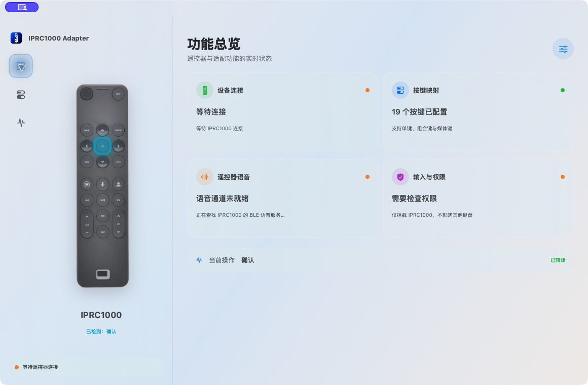
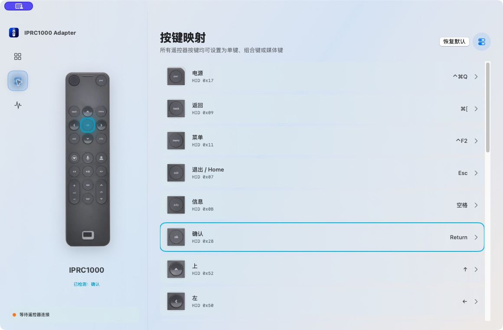
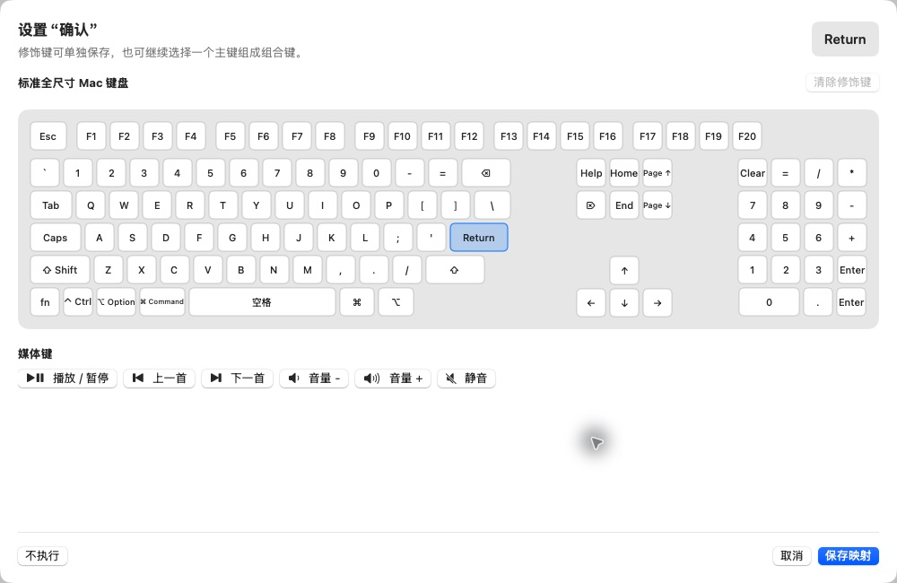

# IPRC1000 Adapter for macOS



IPRC1000 Adapter 是一款常驻 macOS 菜单栏的遥控器适配工具，面向产品名为
`IPRC1000`、VID/PID 为 `0A5C:8502` 的 Broadcom/Cypress 蓝牙遥控器。它可以拦截
遥控器原始键值，将每个按键重新映射为 Mac 单键、组合键或媒体键。

> 当前语音路径：**目标遥控器 IOHID 独占按键 + Apple PacketLogger 临时 HCI 音频接收**。
> 不注册全局键盘事件钩子，不对其他键盘做候选按键延迟。PacketLogger 的底层流包含本机
> 其他蓝牙流量；临时管理员进程只解析目标 F7，向前台交付目标音频与独占读取的按键，
> 不保存原始抓包。开始捕获需要管理员认证，不安装常驻服务。

## 下载与安装

从 [GitHub Releases](https://github.com/wangchll/IPRC1000/releases/latest) 下载
适合本机架构的 **v0.3.0** 安装包：

- Apple Silicon：`IPRC1000-Adapter-0.3.0-AppleSilicon-GitHub-AdHoc.dmg`。
- Intel：`IPRC1000-Adapter-0.3.0-Intel-GitHub-AdHoc.dmg`。

随附SHA-256校验文件；v0.2.2及更早版本不包含本次新增的语音适配。安装步骤：

1. 打开 DMG，把 `IPRC1000 Adapter.app` 拖入“应用程序”。
2. 首次启动时，如果 macOS 提示无法验证开发者，先尝试打开一次应用，然后进入
   “系统设置 → 隐私与安全性”，在安全性区域选择“仍要打开”。
3. 回到应用，根据提示授予“输入监控”和“辅助功能”权限。

当前发布包使用 ad-hoc 签名，没有 Developer ID，也没有经过 Apple 公证。ad-hoc 签名能
保证 App Bundle 内部代码签名一致，但不能向 Gatekeeper 证明开发者身份，因此首次打开会
有额外安全提示。请只从本仓库 Release 下载，并在安装前核对 Release 中的 SHA-256。

## 功能

- 通过产品名、VID/PID、Bluetooth 传输及唯一已配对地址匹配目标设备；地址只在运行期使用。
- 将遥控器按键映射为任意 Mac 键盘单键、最多五种修饰键组合或系统媒体键。
- 支持只发送 `Control`、`Option`、`Shift`、`Command`、`Fn` 等修饰键。
- 过滤遥控器松键时错误产生的 `0x0C`（字母 `i`）报告。
- 提供连接状态、最近按键、目标按键/F7 计数和语音电平。
- 支持 macOS 本机中文识别后写入光标，或把实时音频送入微信语音输入法。

## 系统要求

- macOS 14 或更高版本。
- 一只产品名为 `IPRC1000`、VID/PID 为 `0A5C:8502` 的遥控器。
- 从源码构建需要 Apple Command Line Tools、Swift 6，以及项目当前固定使用的
  `MacOSX15.4.sdk`；若本机没有此 SDK，可明确设置 `IPRC1000_SDK_PATH` 使用与编译器匹配的已安装 SDK。
- 微信模式还需要 BlackHole 2ch、微信输入法及 Apple PacketLogger；详见下文。

## 构建与运行

仓库已经包含预编译的 `Vendor/lib/libsbc.a`。一般情况下无需重新编译 libsbc：

```sh
git clone https://github.com/wangchll/IPRC1000.git
cd IPRC1000

export SDKROOT="${IPRC1000_SDK_PATH:-/Library/Developer/CommandLineTools/SDKs/MacOSX15.4.sdk}"
export CLANG_MODULE_CACHE_PATH=/private/tmp/iprc1000-module-cache
export SWIFT_MODULECACHE_PATH=/private/tmp/iprc1000-module-cache
swift build --disable-sandbox -c release --sdk "$SDKROOT"
```

运行开发构建：

```sh
"$(swift build --disable-sandbox -c release --sdk "$SDKROOT" --show-bin-path)/IPRC1000Adapter"
```

生成两个不同名称的 `.app`（不会替换本机 `/Applications` 中的应用）：

```sh
# 使用当前已安装且与 Swift 编译器匹配的 SDK；未设置时脚本沿用项目默认 15.4。
export IPRC1000_SDK_PATH=/Library/Developer/CommandLineTools/SDKs/MacOSX26.5.sdk
IPRC1000_PACKAGE_VARIANT=GitHub-AdHoc IPRC1000_CODE_SIGN_IDENTITY=- scripts/package-app.sh
IPRC1000_PACKAGE_VARIANT=Local IPRC1000_CODE_SIGN_IDENTITY="你的本机签名身份" scripts/package-app.sh
```

产物分别为 `dist/IPRC1000 Adapter GitHub-AdHoc.app` 和 `dist/IPRC1000 Adapter Local.app`；
脚本逐个执行严格签名校验。未设置 `IPRC1000_PACKAGE_VARIANT` 时，保留原有
`dist/IPRC1000 Adapter.app` 输出位置，并覆盖该位置。`--show-bin-path` 用于获取实际
SwiftPM 输出目录，兼容不同版本的构建后端。

如果需要从源码重建 libsbc，再运行：

```sh
scripts/build-libsbc.sh
```

Intel Mac 使用独立的 x86_64 编译和打包流程，不会替换 Apple Silicon 的构建产物：

```sh
scripts/build-libsbc-intel.sh
scripts/package-app-intel.sh
# 同样可以设置 IPRC1000_PACKAGE_VARIANT=Local 或 GitHub-AdHoc
```

Intel 产物要求 macOS 14 或更高版本。发布 DMG 时请在文件名中保留 `Intel` 标记，
例如 `IPRC1000-Adapter-0.3.0-Intel-GitHub-AdHoc.dmg`。Intel 版使用独立的
`Vendor/lib-intel`；二进制位置通过指定 triple 后的 `--show-bin-path` 获取。
较新的 SwiftPM/Xcode 后端可能复用 `.build/out` 中间目录，因此构建两种架构应顺序执行，
分发产物保持不同名称，不并行覆盖。

## 首次使用

1. 在 macOS 蓝牙设置中配对并连接 `IPRC1000` 遥控器。
2. 启动 IPRC1000 Adapter。关闭设置窗口不会退出应用，它仍会常驻菜单栏。
3. 根据界面提示授予“输入监控”和“辅助功能”权限：
   - 输入监控：读取目标遥控器 HID 报告。
   - 辅助功能：发送重新映射后的键盘和媒体键事件。
4. 返回应用总览，确认“设备连接”显示在线，然后按遥控器按键检查“当前操作”。
5. 如果修改权限后状态没有刷新，退出并重新启动应用。

## 独立按键接管（0.3.1 测试版）

测试包见 [v0.3.1-rc.1](https://github.com/wangchll/IPRC1000/releases/tag/v0.3.1-rc.1)，尚待另一台Mac真机验证，不替换正式最新版。

在“连接诊断”点击“启用独占按键适配”，完成系统认证。此路径不要求 PacketLogger、蓝牙日志描述文件或 BlackHole。
它仅独占唯一配对目标的键盘，原始M/I被隔离，按当前映射转发。首次启动仍需要输入监控与辅助功能权限。
“停止接管”结束管理员进程并释放设备；“停止语音”只停止音频，保留按键接管。

v0.3.0 把管理员键盘与音频工具前置校验绑在一起：缺少 PacketLogger 会报 -1001 并阻止独占接管。
0.3.1测试版拆开这个依赖，**语音接收仍需要 Apple PacketLogger**，不是新的无工具语音后端。
普通模式“需要唯一匹配遥控器地址的键盘服务”表明目标身份已通过、服务映射未就绪；不表示地址写死。

## 遥控器语音与光标输入

1. 安装 `BlackHole 2ch`，从 Apple 的 Additional Tools for Xcode 安装 `PacketLogger.app`
   到 `/Applications`；蓝牙日志描述文件需要对当前系统有效。程序会验证 PacketLogger 的 Apple 签名，
   不会自动下载工具、安装描述文件或更改系统蓝牙日志配置。
2. 在“连接诊断”点击“启动临时蓝牙语音”，完成系统管理员认证。
   “输入监控”与“辅助功能”仍是独立权限；管理员身份不能替代输入监控授权。
3. 选择识别方式并点击“启用光标处语音输入”：
   - **macOS 本机识别**：`SFSpeechRecognizer(zh-CN)`，强制 `requiresOnDeviceRecognition`。
     中文模型不可用时提示错误，不退回云端；完成识别后在本次说话开始时捕获的输入框粘贴。
   - **外部语音输入法（微信等）**：已验证的是微信的 **Fn 长按模式**。在微信输入法中开启
     Fn 语音快捷键、把麦克风选为“自动检测”。按住遥控器时临时选择微信输入源和 BlackHole，
     流式转发 PCM，排空后释放 Fn 并恢复原麦克风与输入源。识别与文字落点由微信输入法负责，
     是否联网由该输入法决定。其他快捷键/输入法只提供配置入口，未做端到端验收。
4. **点击目标应用的普通文本输入框**，直接按住遥控器麦克风说话，松开结束。
   文字应进入光标处，不需要停留在适配器窗口。普通按键继续按当前配置转发。
5. 停用输入结束转写/微信会话；0.3.1测试版“停止语音”仅停止音频，“停止接管”才释放独占设备。
   正常退出应用也会清理临时捕获，不安装系统服务。

底层音频是 `Classic HID Interrupt → F7 → Int16LE PCM`，不是 mSBC、ADPCM 或 Mac 麦克风录音。
当前 IOHID 实测只交付键盘 Report ID 1，不交付隐藏 F7，所以音频使用获授权的临时 HCI 路径。
独占键盘管理器在重连前已打开，并仅匹配目标实物；接管时读取该目标缓存的麦克风状态，
补交已发生的冷唤醒按下，避免必须再次按键。HID rollover 错误不会当成松开。

2026-11-03 本机 `.33` 已通过冷唤醒一次按住、微信真实文字写入、半秒间隔两句、M/I 零漏出、
Fn 释放及麦克风恢复的实测。当前源码构建 `.34` 还修复了 review 发现的异常报告、识别完成竞态
和打包问题，详见验证记录；不把自动测试当作新版本的真机验收。首次音频组件初始化曾耗时
约 2.1 秒，后续真实冷重连从设备枚举到 Fn 约 0.18 秒，不代表所有冷启动均能保证相同延迟。

临时提权接口 `AuthorizationExecuteWithPrivileges` 已弃用，重新启动捕获仍可能认证；
没有实现或安装免重复认证服务。Apple 捕获工具/系统版本变化也可能影响该入口。
**v0.3.0（构建20261103.34）提供上述两个架构的Release安装包；它没有自动替换本机已验证的 `.33`。**

- [逐字节语音协议](docs/VOICE_PROTOCOL.md)：封装、偏移、采样参数、筛选和未决字段。
- [实现与生命周期](docs/VOICE_IMPLEMENTATION.md)：键盘独占、通信、识别、流式送音和恢复。
- [Review 与验证](docs/REVIEW_20261103.md)：修复项、自动验证、真机证据边界。
- [临时捕获依赖与权限](docs/CAPTURE_SERVICE.md)。

## 自定义按键映射

打开左侧“按键映射”，可以查看所有遥控器按键及其当前动作。



修改一个按键：

1. 点击要修改的遥控器按键，例如“确认”或“返回”。
2. 在全尺寸 Mac 键盘中选择一个主键；再次点击已选主键可更换选择。
3. 如需组合键，先选择 `Control`、`Option`、`Shift`、`Command` 或 `Fn`，再选择主键。
4. 只选择修饰键、不选择主键，可以保存为单独的修饰键动作。
5. 也可以直接选择“播放/暂停”“上一首”“下一首”“音量”“静音”等媒体键。
6. 选择“不执行”可禁用该遥控器按键。
7. 点击“保存映射”立即生效；点击“取消”不会修改现有配置。



映射保存在当前 macOS 用户的应用偏好设置中。右上角“恢复默认”会重置所有按键，
因此使用前请确认不再需要现有自定义配置。

按键映射页底部支持多组配置 Tab：使用“+”复制当前映射并创建自动编号的新配置组，单击
Tab 切换配置组，双击 Tab 可重命名，“-”用于删除当前组（至少保留一组）。搜索框可按
遥控器按键名、HID 值或映射动作查找条目。“导出”只保存当前选中的配置组；“导入”只会
替换当前组的按键映射，不影响其他配置组。

首次运行会提供“默认配置组 1”和“Codex 编程”两套配置。遥控器最底部的方块键固定用于
切换到下一配置组，循环切换且不会向 macOS 发送普通按键。Codex 编程配置提供新建
（⌘N）、查找（⌘F）、保存（⌘S）、命令面板（⇧⌘P）、前后切换（⇧Tab / Tab）、
翻页、方向导航和常用媒体控制。

### 默认映射

| 遥控器按键 | 默认动作 | 遥控器按键 | 默认动作 |
| --- | --- | --- | --- |
| 电源 | `Control + Command + Q` | 返回 | `Command + [` |
| 菜单 | `Control + F2` | 退出 / Home | `Esc` |
| 信息 | `Space` | 确认 | `Return` |
| 上 / 下 | `↑` / `↓` | 左 / 右 | `←` / `→` |
| 爱心 | 不执行 | 功能键 `0x10` | 不执行 |
| 用户 | 不执行 | 方块键 `0x16` | 切换到下一配置组 |
| 播放 / 暂停 | 播放 / 暂停 | 快进 / 快退 | 下一首 / 上一首 |
| 频道 + / - | `Page Up` / `Page Down` | 音量 + / - | 系统音量 + / - |
| 静音 | 系统静音 | 上一个 | `Command + Tab` |

## 连接诊断

打开左侧“连接诊断”，可以检查按键通道和最近检测到的遥控器按键。

按键没有反应时依次检查：

1. macOS 蓝牙设置中是否已连接 `IPRC1000`。
2. App 总览是否识别到 `IPRC1000（0A5C:8502）`。
3. 系统设置 → 隐私与安全性中是否允许“输入监控”和“辅助功能”。
4. 运行内置自测，确认按键解析、型号隔离和事件过滤逻辑：

   ```sh
   "$(swift build --disable-sandbox -c release --sdk "$SDKROOT" --show-bin-path)/IPRC1000Adapter" --self-test
   ```

## 隔离范围说明

语音模式的 IOHIDManager 在枚举前设置 VID/PID、产品名、Bluetooth 与精确 SerialNumber
匹配，以 `kIOHIDOptionsTypeSeizeDevice` 打开当前和未来的目标设备。不会使用全局 CGEventTap
读取或延迟其他键盘事件。非语音启动路径保留目标键盘服务的 `UserKeyMapping` 映射；
该映射写入回读不等同于原始事件隔离验收，可靠拦截的本轮验证使用的是临时独占路径。

PacketLogger 的底层 HCI 流范围与键盘独占不同：它包含其他本机蓝牙包。严格目标过滤发生在
管理员进程内，不保存原始流；只把目标 F7 和通过 IOHID 独占读到的目标按键交给前台。
未经身份校验的包不能仅凭出现 F7 字节就作为音频。不要将此入口称为“底层只读单设备”。

## 实验与研究记录

- [IPRC1000 语音实验记录](docs/VOICE_EXPERIMENT_NOTES.md)：汇总已尝试的协议路径、真机
  观察和失败路径；旧日期章节保留当时结论，当前状态以上述协议、实现与验证文档为准。

## 开源协议与第三方内容

项目原创代码和文档采用 [MIT License](LICENSE)，允许使用、修改、分发和商业使用，但需
保留版权与许可声明。

第三方内容不因项目采用 MIT 而改变原许可证或权利归属：

- VibeStick 微信流式组件沿用其 MIT 许可，来源及本地适配见 [NOTICE.md](NOTICE.md)。
- BlueZ SBC 库保持 `LGPL-2.1-or-later`；上游源码归档中的独立命令行工具按其文件标记
  使用 `GPL-2.0-or-later`。
- `Vendor/Source/sbc-2.2.tar.xz` 提供对应的未修改源码和完整上游许可证文本。
- IPRC1000 产品照片及截图中重现该照片的部分不包含在 MIT 授权范围内。

完整范围、来源与重新链接说明见 [NOTICE.md](NOTICE.md)。
