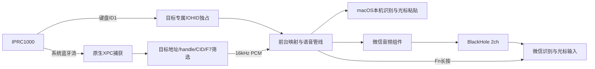

# 语音适配实现与生命周期

## 数据路径

按键只读取唯一配对目标，无全局键盘钩子。原生捕获底层是本机HCI流，仅在管理员进程筛选目标，不保存原始抓包。无需PacketLogger可执行文件或蓝牙描述文件。

## 模块

| 文件 | 职责 |
| --- | --- |
| `HIDController` / `DeviceVoiceInput` | 目标身份、预先独占、冷首键缓存、按键状态及重复 |
| `HCICapture.c` | 临时系统认证与父子通信，不安装服务 |
| `NativeCapture.m` / `NativePacketFilter.c` | 正常XPC认证、目标链路学习、分片重组、有界队列 |
| `ScopedHCITrace` | CFPreferences配置事务、互斥、恢复日志、独立拥有者EOF清理 |
| `TemporaryVoiceCapture` | 按键与音频独立启停，错误恢复不释放键盘 |
| `HCIVoiceInput` / `CaptureOutputBuffer` | 仅目标消息、非阻塞控制通信、前台状态 |
| `VoicePipeline` | PCM/序号处理、最多5帧缺口补零、段结束判定 |
| `ExternalVoiceInput` / `VoiceWarmup` | 输入源、麦克风、Fn、首音缓存、接续与超时 |
| `PCMStreamWriter` | 有界非阻塞发送、取消、背压及EPIPE处理 |
| `VoiceTranscription` / `CursorTextInput` | 本机识别、结果顺序、焦点保护和剪贴板恢复 |

## 按键与冷重连

管理员IOHIDManager在枚举前按型号、传输和系统配对地址匹配目标，并以SeizeDevice打开。设备移除时释放当前状态，管理器保持等待重连。首个麦克风按下可能早于回调，接管后仅从目标缓存元素恢复确切按住状态，不向设备发送GetReport。I usage过滤，rollover错误不当作松开，映射修饰键按按下时的绑定释放。

普通未独占路径仍保留目标UserKeyMapping；属性回读不是可靠拦截证明，用户正常使用需启用独占接管。地址运行时取得，不写死本机设备。

## 配置与进程

正常语音启动创建应用拥有的持续配置租约，设置raw/HID/live为真、file/skipAuth为假，保留正常系统认证。配置发布使用CFPreferences，拒绝受管理值或其他作用域覆盖。root专属恢复日志与文件锁避免并发覆盖，恢复时保留外部变更。

正常会话不设置自动到期时间，运行至停止语音或退出。开发用五分钟路径单独保留，接收端在兜底期限前先断开XPC，再恢复配置，避免服务关闭与活跃连接竞争。正常语音停止同样先取消XPC并等异步终止事件，再关闭配置控制管道。

“停止语音”保留键盘。“停止接管”或退出应用关闭整条会话。拥有者死亡产生EOF时独立配置进程恢复；所有相关进程同时被强杀或整机崩溃时，需下次启动租约恢复，当前不安装常驻监管服务。

## 通信

前台仅发送固定字节A（持续音频）、D（五分钟开发验证）、S（停止音频）、R（重试）；不执行外部字符串。管理员只发送目标K键盘、F音频、I独占、M音频模式及状态消息。音频错误或重试不会退出键盘管理器；真正EOF/通信硬错误才结束会话。

## 微信流式输入

正常按钮同时请求光标输入；目标独占建立后才允许Fn。保存原输入源与麦克风、选择微信和BlackHole，启动捆绑audio-only组件。组件启动engine/player后发READY，前台按Fn并预热350ms；期间目标PCM缓存在内存，之后按序排空并实时送入组件。组件每次读取640字节，20ms调度，避免攒半秒。

启动/下一句等待缓存各最多5秒；实时发送队列最多160000字节。写入可取消，单批2秒未完成报错。组件启动5秒、结束10秒兜底，异常时释放Fn、恢复麦克风并结束自己的组件。正常段结束等待PCM排空及尾部等待，后续一段若已开始则保存并接续。旧组件回调按进程身份拒绝，取消后的READY不能再次按Fn。

恢复前比较默认输入和输入源仍是程序临时选择，避免覆盖用户主动修改。微信负责识别与光标写入，是否联网由微信决定。

## 本机识别

中文SFSpeechRecognizer强制本机识别，PCM来自F7，不读取Mac麦克风；无本机资源时报错而不退回云端。每句记录输入目标，结果只在原前台及控件焦点仍有效时粘贴，拒绝密码框。结果按说话顺序提交，避免旧句最终结果覆盖下一句；剪贴板仅在未被其他程序修改时恢复。

协议见[VOICE_PROTOCOL](VOICE_PROTOCOL.md)，构建与回归见[DEVELOPMENT](DEVELOPMENT.md)。日期命名的研究记录保留当时状态，不作为当前用户流程。
