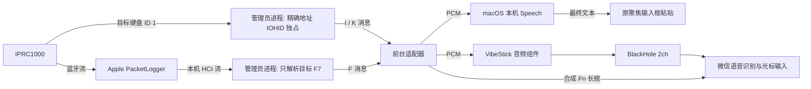

# 语音适配实现与生命周期

## 数据路径



IOHID 只匹配这只遥控器，**PacketLogger 底层仍接触本机其他蓝牙包**，过滤在管理员进程内部完成。
无全局键盘事件监听、无候选按键等待、无原始 HCI 文件输出。其他键盘没有被接管。

## 模块职责

| 文件 | 职责 |
| --- | --- |
| `HIDController.swift` / `DeviceVoiceInput.swift` | 目标身份、独占、报告回调、冷首键缓存恢复、去重/松开及按键重复 |
| `TemporaryVoiceCapture.swift` | 临时管理员会话，同时拥有目标键盘与 Apple 音频子进程；后者异常时只重启音频 |
| `HCICapture.c` | Apple 签名检查、系统认证及双向临时通信；不安装系统服务 |
| `HCIVoiceInput.swift` | 前台读取过滤后消息、计数、隔离/音频状态、严格 HCI 解析和恢复水位 |
| `CaptureOutputBuffer.swift` | 非阻塞写队列，EAGAIN 保留数据重试，不能因此退出释放键盘 |
| `VoicePipeline.swift` / `BlackHoleOutput.swift` | PCM/序号处理、500 ms 段结束、连续重采样与有界输出队列 |
| `ExternalVoiceInput.swift` | 微信输入源、临时麦克风路由、Fn、音频组件与快速接续会话 |
| `Vendor/VibeStick/wechat_input.swift` | 16 kHz Int16 PCM → AVAudioEngine → BlackHole；音频排空后退出 |
| `VoiceTranscription.swift` / `CursorTextInput.swift` | 本机中文 Speech、分句最终结果排序、每句输入目标与粘贴回读 |
| `AppModel.swift` | 启用意图、UI、映射与各通路生命周期联动 |

## 键盘独占与冷重连

在枚举前注册 manager 报告回调与设备回调，匹配包含 VID、PID、产品名、Bluetooth 与规范化精确 SerialNumber。
`IOHIDManagerOpen(kIOHIDOptionsTypeSeizeDevice)` 预先覆盖当前和未来的目标设备；设备回调再次核验身份和打开返回值。
即使 open 现有设备失败，manager 仍可能已经标为 open，停止时也必须 close，避免下次连接被意外接管。

首个唤醒按下可能先于回调订阅。接管后只读取目标的麦克风元素缓存：
`IOHIDDeviceGetValueWithOptions(...withoutUpdate)` 不发送 GetReport；只有缓存明确按住才补交初始 M。
重复的实时 M 由 pressed 集合去重，HID rollover/POSTFail/undefined 保留旧状态，I 永不作为有效功能键转发。

`AppModel` 只从这条目标报告流执行映射。纯修饰键保存其按下时的绑定，释放时优先释放该绑定，避免中途启用语音/修改配置后留下按住状态。
正常退出、目标移除或手动停止均释放映射的修饰键。目标睡眠只关闭当前设备，manager 保持预先打开，下一次冷连接无需重启捕获。

未启动临时独占时保留目标 `UserKeyMapping` 路径；该路径回读成功不等于原始事件隔离通过，不能拿它替代这里的真机独占验证。

## 临时通信与故障恢复

管理员进程经 `AuthorizationExecuteWithPrivileges` 启动，参数是唯一配对地址，不接收任意 shell 命令。
0.3.1起，管理员启动先仅接管键盘，不校验或启动PacketLogger。只有前台明确请求音频时才验证并启动Apple工具；
缺工具、签名错误、音频停止均保留目标键盘接管。语音本身仍依赖PacketLogger。
该已弃用接口用于当前兼容路径；启动捕获可能需要再次认证，不是安全的常驻 helper 方案。

换行分隔的消息如下（仅发送目标数据）：

| 消息 | 含义 |
| --- | --- |
| `READY` | 临时会话启动，不等于设备已连接 |
| `I 1` / `I 0` | 目标独占已建立 / 丢失 |
| `K <18位HEX>` | 9 字节目标键盘报告 |
| `F <十进制handle> <base64>` | 已筛选的 652 字节目标 F7 报告 |
| `M 1` / `M 0` | 音频模式开启 / 关闭，与键盘隔离状态独立 |
| `A 0` | 音频进程重置；键盘独占保持，前台结束旧语音会话 |
| `S <状态>` / `ERROR <原因>` | 状态或终止错误 |

前台仅可发固定单字节 `A`（开启音频）、`S`（停止音频）和 `R`（已开启时重试音频）；
其他命令结束会话，不执行外部字符串。手动停止并重新开启音频会清除恢复水位，避免重放停用期间的缓冲包。
写入队列在 EAGAIN 时重试；音频队列达 256 KiB 后丢弃新增音频，保留控制容量，总队列上限 1 MiB。
真实 EOF/EPIPE/硬错误才终止。Apple 输出单行超过 64 KiB 时丢弃该行至换行，不能连带释放键盘。
音频子进程退出后清理并指数退避重启（0.25 秒起、最多 30 秒），恢复水位阻止重放旧音频。

停止/正常退出：前台关闭通信 → 管理员检测 EOF → 释放目标 HID → 结束 PacketLogger 并 wait 回收。
如果系统强杀管理员进程，Swift defer 不能保证执行；这种情况的强制清理不是已实现的受监督系统服务能力。

## 微信流式输入

配置要求：微信输入法已启用 Fn 长按语音，麦克风为“自动检测”，系统已安装 BlackHole 2ch。

1. 目标麦克风按下后，保存原输入源/默认麦克风，选择微信并临时把默认输入改为 BlackHole。
2. 启动捆绑组件 `--stream --audio-only`，组件不读物理麦克风、不合成 Fn、不保存音频。
3. 组件发出 `IPRC_AUDIO_READY` 后，主程序再次检查目标独占仍有效，合成 Fn flagsChanged 按下。
4. 目标 F7 解出 PCM 后写入组件 stdin，按实时流送入 BlackHole。组件的播放启动等待为 0.35 秒。
5. 段结束关闭 stdin，组件等待已排队 PCM 播放完成（最多 8 秒）和 0.8 秒尾部等待；退出后主程序释放 Fn，恢复原麦克风和输入源。
6. 如果上句排空期间已收到下一次按住，保留下一段音频和结束状态，接续下一个组件；正常快速接续可保留 Fn 到最后一段结束。

恢复前会比较当前麦克风/输入源仍是本程序临时选择的值，避免覆盖用户期间主动修改的选择。
修改外部快捷键/触发方式先停用当前输入并恢复现场，需要重新启用后生效；通用快捷键路径显式恢复直接BlackHole输出。
取消会阻止后到的 READY 重新按下 Fn。微信负责识别/光标插入；适配器不会把微信的结果伪装成本机 Speech。

## macOS 本机识别

`SFSpeechRecognizer(zh-CN)` 强制 `requiresOnDeviceRecognition`；无模型时报错，输入 PCM 直接来自 F7，未安装音频输入 tap。
每句开始独立捕获 AX 输入目标，最终结果只在前台应用和聚焦控件仍相同时粘贴，拒绝密码框。
使用普通粘贴兼容 Chromium 的 AXSelectedText 假成功问题；剪贴板在没有其他写入时恢复原内容，随后回读字段验证。

上一句 endAudio 后不因下一句开始而取消其任务。不同句的结果使用序号保留并按说话顺序提交；
旧句完成不能清空新句 request，重复结果不能插入两次。最终文字按至少1.1秒间隔提交，让前一次普通粘贴及1秒剪贴板恢复完成；
每次实际提交仍重新检查原输入框焦点，避免结果同时到达时串句或写到新焦点。停用会清空待提交文字、取消所有任务并使旧回调失效。
这些 review 后的并发状态修复有自动回归；不能代替修改后 macOS Speech 真机识别测试。

## 开发验证与实验工具

`--self-test` 不打开 HID、不提权、不发 Fn；覆盖协议/隔离/队列/序号/识别结果时序。
`--check-hci-trace <tsv> <示例或本机目标地址>` 为本地文件解析，不启动 live 抓取。
`--diagnose-exclusive <12位HEX地址>` 需要明确目标，仅计数；最长等设备 15 分钟，按住后最长 2 分钟。
`--replay-wechat[-rapid]` 会实际切换输入和合成 Fn，仅用于用户主动安排的本地回放，不纳入无人值守常规自测。

`Tools/TargetBluetoothProbe` 保留历史定向 L2CAP 实验，不被产品调用。`--run`/`--listen` 会尝试目标 ignore hint 或打开通道，
`--interrupt` 也发起异步通道请求；它们不是普通只读检查，不应作为安装/启动前置。其成功返回过请求对象但没有获得真实 F7，
详见历史研究记录；本次只运行不访问硬件的 `--self-test`。

## 0.3.1无工具启动回归

`Tools/CaptureStartupSelfTest/main.c`直接包含生产C启动代码；将PacketLogger存在性检查模拟为ENOENT、系统认证/执行替换为无权限副作用的桩。
验证缺工具仍进入管理员按键启动流程、目标参数准确传递、FD带CLOEXEC、取消认证不启动进程、通信缺失明确报错。
此测试不运行真正管理员进程，不代替另一台Mac的独占验收：

```sh
clang -O1 -g -fsanitize=address,undefined -I Sources/CRemoteSupport/include \
  -framework Security -framework CoreFoundation \
  Tools/CaptureStartupSelfTest/main.c -o /private/tmp/iprc-capture-startup-selftest
/private/tmp/iprc-capture-startup-selftest
```
